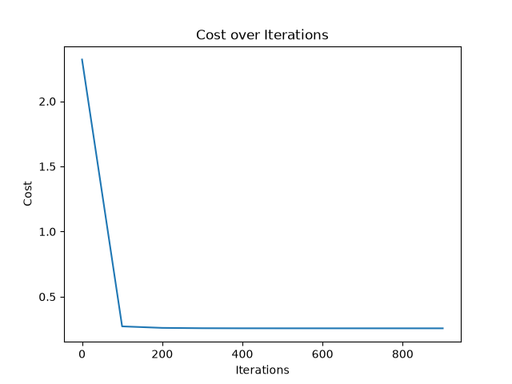

# California House Price Prediction

Linear regression built **from scratch with NumPy** using gradient descent. This is Project 1 of my portfolio after completing the Machine Learning Specialization.

## Goal

Predict the median house value of a California district from 8 census features, implementing the algorithm by hand (cost function, gradient, update rule) instead of calling a library.

## Dataset

[California Housing](https://scikit-learn.org/stable/modules/generated/sklearn.datasets.fetch_california_housing.html), loaded with `sklearn.datasets.fetch_california_housing`:

- 20,640 districts, 8 numeric features, no missing values
- Features: `MedInc`, `HouseAge`, `AveRooms`, `AveBedrms`, `Population`, `AveOccup`, `Latitude`, `Longitude`
- Target: median house value in units of $100,000 (capped at 5.0, i.e. $500k)

## Approach

1. **Split:** 60% train / 20% validation / 20% test (`random_state=42`). The test set is held out and not used yet.
2. **Feature scaling:** z-score standardization. The mean and standard deviation are computed per column on the training set only, then applied to validation and test, so there is no data leakage.
3. **Model:** `f(x) = w·x + b`
4. **Cost:** mean squared error, `J(w, b) = 1/(2m) · Σ (f(x) − y)²`
5. **Training:** batch gradient descent, fully vectorized with NumPy
   - Learning rate α = 0.1
   - 1000 iterations
   - Weights start at zero
6. **Evaluation:** RMSE and R² on the validation set.

## Results

Validation set:

| Metric | Value |
|---|---|
| RMSE | 0.7298 (about $73k average error) |
| R² | 0.5920 |

The model explains about 59% of the variance in house prices. The cost drops quickly in the first iterations and then flattens, as expected for a convex problem (`cost_plot.png`).



## How to run

```bash
pip install numpy scikit-learn matplotlib
python housing_prediction.py
```

The script prints the validation RMSE and R² and saves `cost_plot.png`.

## Project structure

```
.
├── housing_prediction.py   # data loading, scaling, model, training, evaluation
├── cost_plot.png           # generated cost curve
└── README.md
```

## Limitations

- A purely linear model has limited capacity (R² ≈ 0.59).
- House prices in the dataset are capped at $500k, which hurts predictions at the top end.
- Only the validation set has been used so far; the test set is reserved for the final model.

## Next steps

- [ ] Compare the from-scratch weights with scikit-learn's `LinearRegression`
- [ ] Add a "predict the mean" baseline
- [ ] Learning rate experiment (α = 0.001, 0.01, 0.1, 0.5)
- [ ] Exploratory data analysis (distributions, correlations, outliers)
- [ ] Polynomial features and learning curves (bias vs. variance)
- [ ] Ridge and Lasso regularization, with λ chosen on the validation set
- [ ] Final evaluation on the test set and error analysis

## What I learned

- How gradient descent works end to end, and how to vectorize it.
- Why scaling statistics must come from the training set only, and why `axis=0` matters.
- How to read a cost curve to check that training is working.
